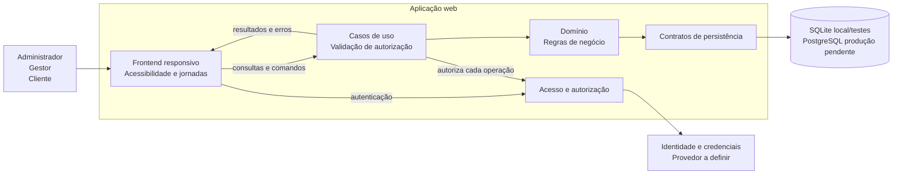

# Arquitetura do CineSenac

## Propósito e estado

Este documento registra a arquitetura lógica e o estado atual do protótipo web de gestão de sessões de cinema. A implementação usa Python, Flask, Jinja e SQLite local; essas escolhas não significam que a implantação de produção esteja definida.

## Escopo e referências

A aplicação atende às jornadas do [administrador do sistema](../persona/administrador-do-sistema.md), [gestor](../persona/gestor.md) e [cliente](../persona/cliente.md). Os comportamentos estão descritos nos [requisitos funcionais](../requisitos-funcionais.md), os atributos de qualidade nos [requisitos não funcionais](../requisitos-nao-funcionais.md), as entidades no [modelo relacional](../modelagem-dados.dbml), e os diagramas nos documentos de [modelagens estáticas](../modelagens-estaticas/README.md) e [modelagens dinâmicas](../modelagens-dinamicas/README.md).

## Visão lógica

A implementação separa a apresentação web, os casos de uso, o domínio e o acesso a dados. O servidor é responsável pela autorização e pelas regras de negócio; o frontend não é uma fronteira de segurança. O adaptador SQLite fornece persistência local e de testes. A integração de produção com PostgreSQL ainda precisa ser implementada.

Uma versão mais detalhada dos componentes está na [modelagem estática de componentes](../modelagens-estaticas/diagrama-componentes.md).

## Responsabilidades e limites

| Elemento | Responsabilidade |
|---|---|
| Frontend | Templates Jinja e CSS para apresentar jornadas e coletar entradas; não substitui validações do servidor. |
| Casos de uso | Rotas Flask coordenam cadastros, consultas e reservas e aplicam autorização no servidor para as operações de gestão. |
| Acesso e autorização | Contas locais `admin` e `manager`, hash de senha do Werkzeug e sessão assinada pelo Flask; formulários POST protegidos por token CSRF. Provedor externo e autenticação persistente de clientes não estão implementados. |
| Domínio | Serviços Python validam os dados, disponibilidade, unicidade de assentos e conflitos de horário. |
| Persistência | SQLite usa restrições, chaves estrangeiras e transações para ambiente local/teste; ainda não há adaptador PostgreSQL intercambiável. |
| Armazenamento | Persistir contas, salas, filmes, sessões, assentos, clientes, lotes idempotentes e reservas. |

## Táticas arquiteturais propostas

As táticas abaixo atendem aos RNFs atuais e são registradas nos ADRs vinculados. ADRs com estado **Proposto** documentam direções para validação, não decisões implementadas. Veja o estado do protótipo nos próprios ADRs.

| Tática | Objetivo | Rastreabilidade | ADR |
|---|---|---|---|
| Modularidade e separação por responsabilidades | Conter mudanças, manter contratos claros entre frontend, aplicação, domínio e persistência. | RNF01–RNF02, RNF18–RNF20 | [ADR-001](adrs/ADR-001-modularidade-e-camadas.md) |
| Frontend responsivo, acessível e compatível | Atender jornadas em dispositivos e navegadores diferentes. | RNF05–RNF10, RNF21 | [ADR-002](adrs/ADR-002-frontend-web.md) |
| Autorização no servidor e proteção de dados | Evitar depender da interface como controle de acesso. | RNF14–RNF17 | [ADR-003](adrs/ADR-003-seguranca-e-autorizacao.md) |
| Persistência relacional atrás de contratos | Preservar integridade referencial e permitir evolução do armazenamento. | RNF02, RNF12–RNF13, RNF20 | [ADR-004](adrs/ADR-004-persistencia-relacional.md) |
| Reserva transacional e idempotente | Evitar assentos duplicados e confirmações inconsistentes sob concorrência. | RNF11–RNF13 | [ADR-005](adrs/ADR-005-consistencia-de-reservas.md) |
| Escala horizontal e cache seletivo | Sustentar a meta de 10.000 usuários simultâneos sem servir disponibilidade obsoleta. | RNF03–RNF05, RNF11 | [ADR-006](adrs/ADR-006-desempenho-e-escalabilidade.md) |
| Tratamento explícito de falhas | Não retornar sucesso falso e permitir diagnóstico de falhas. | RNF11, RNF13 | [ADR-007](adrs/ADR-007-falhas-e-observabilidade.md) |
| Verificação contínua e contratos testáveis | Detectar regressões e incompatibilidade entre componentes. | RNF01, RNF18–RNF20 | [ADR-008](adrs/ADR-008-qualidade-e-testes.md) |
| Configuração externa e ambientes reproduzíveis | Promover portabilidade entre desenvolvimento, teste e produção. | RNF22 | [ADR-009](adrs/ADR-009-configuracao-e-implantacao.md) |

## Atributos de qualidade e verificações

- **Desempenho e capacidade:** ainda não validado. SQLite local não deve ser interpretado como capaz de atender 10.000 usuários simultâneos. Validar numa infraestrutura de teste e com o banco de produção selecionado.
- **Integridade de reserva:** executar testes concorrentes que tentem reservar o mesmo assento e comprovar uma única reserva confirmada, conforme RNF12.
- **Segurança:** revisar autorização no servidor, transporte seguro, gestão de sessão, exposição de dados e vulnerabilidades web, conforme RNF14–RNF17.
- **Experiência web:** validar acessibilidade WCAG 2.2 AA, tamanhos de viewport e navegadores declarados nos RNF06–RNF10.
- **Manutenibilidade:** manter testes de aceitação e de contrato, além da meta de cobertura de domínio indicada nos RNF18–RNF20.
- **Portabilidade:** implantar o mesmo artefato em ambientes configurados externamente, conforme RNF22.

## Decisões em aberto

- Linguagem, frameworks, protocolo e formato de interface entre frontend e serviços.
- Provedor e modelo de identidade para administrador e gestor, incluindo recuperação e ciclo de vida de credenciais.
- Banco de dados, hospedagem, topologia de implantação e estratégia de backups e recuperação.
- Perfil de tráfego que compõe o teste de 10.000 usuários, infraestrutura de referência e estratégia de geração de carga.
- Política de expiração, cancelamento e pagamento de reservas, ainda não definida nos requisitos funcionais.
- Referência legal e critérios operacionais específicos para a cota diária de filmes nacionais.

Estas escolhas devem ser registradas em novos ADRs ou atualizar ADRs propostos quando houver decisão.
