# Diagramas dinâmicos — sequências por requisito funcional

Os diagramas são modelos lógicos do comportamento previsto e não indicam tecnologias de implementação. Os participantes de interface, aplicação, domínio e persistência representam responsabilidades. Cada seção liga o fluxo aos RNFs aplicáveis; consulte a [matriz resumida](README.md) e os [requisitos não funcionais](../requisitos-nao-funcionais.md) para os critérios completos.

## RF01 — Autenticar administrador e liberar acesso aos fluxos

**Persona:** Administrador do sistema. **RNFs:** RNF01, RNF06, RNF08–RNF09, RNF14–RNF17.

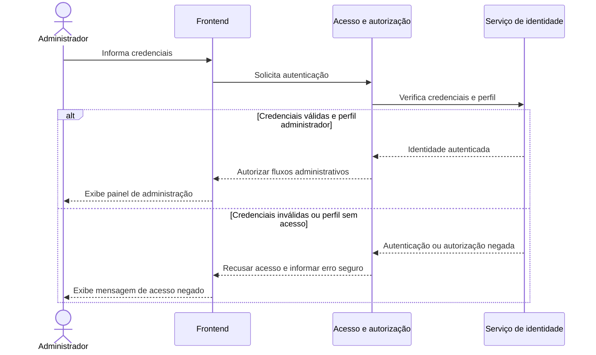

## RF02 — Disponibilizar gestão de salas, filmes e sessões

**Persona:** Gestor. **RNFs:** RNF01, RNF05–RNF06, RNF08, RNF10 e RNF15.

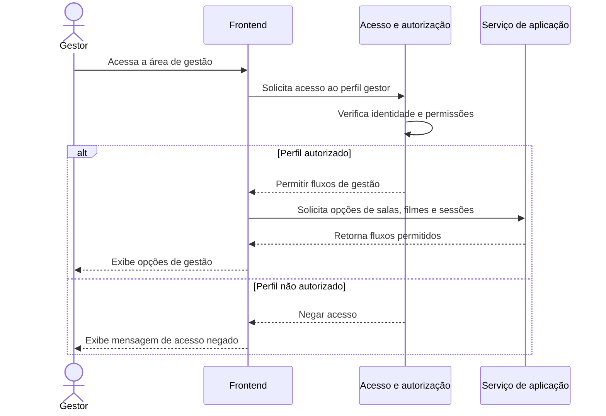

## RF03 — Apresentar fluxos permitidos ao perfil

**Personas:** Administrador do sistema, Gestor e Cliente. **RNFs:** RNF01, RNF03, RNF08–RNF09 e RNF15.

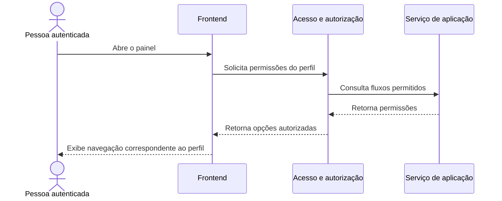

## RF04 — Cadastrar sala

**Persona:** Gestor. **RNFs:** RNF01–RNF02, RNF04, RNF10, RNF13 e RNF15.

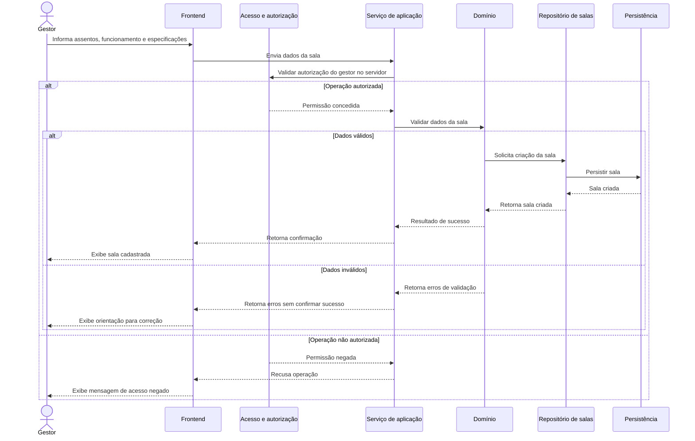

## RF05 — Cadastrar filme

**Persona:** Gestor. **RNFs:** RNF01–RNF02, RNF04, RNF10, RNF13 e RNF15.

## RF06 — Cadastrar sessão

**Persona:** Gestor. **RNFs:** RNF01–RNF02, RNF04, RNF10, RNF13 e RNF15.

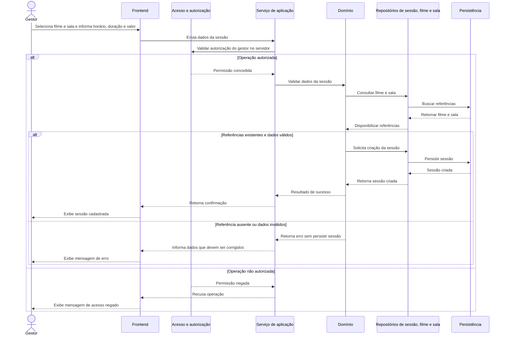

## RF07 — Consultar programação e identificar sessão nacional diária

**Persona:** Gestor. **RNFs:** RNF01–RNF03, RNF10 e RNF13.

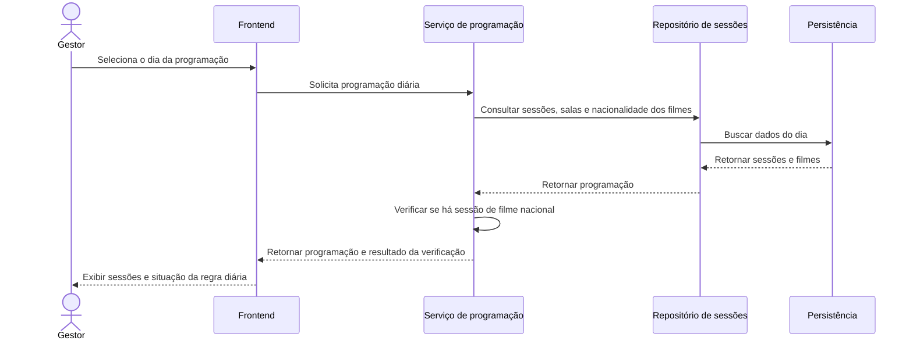

## RF08 — Consultar dados cadastrados

**Personas:** Administrador do sistema e Gestor. **RNFs:** RNF01–RNF03, RNF06, RNF09 e RNF15.

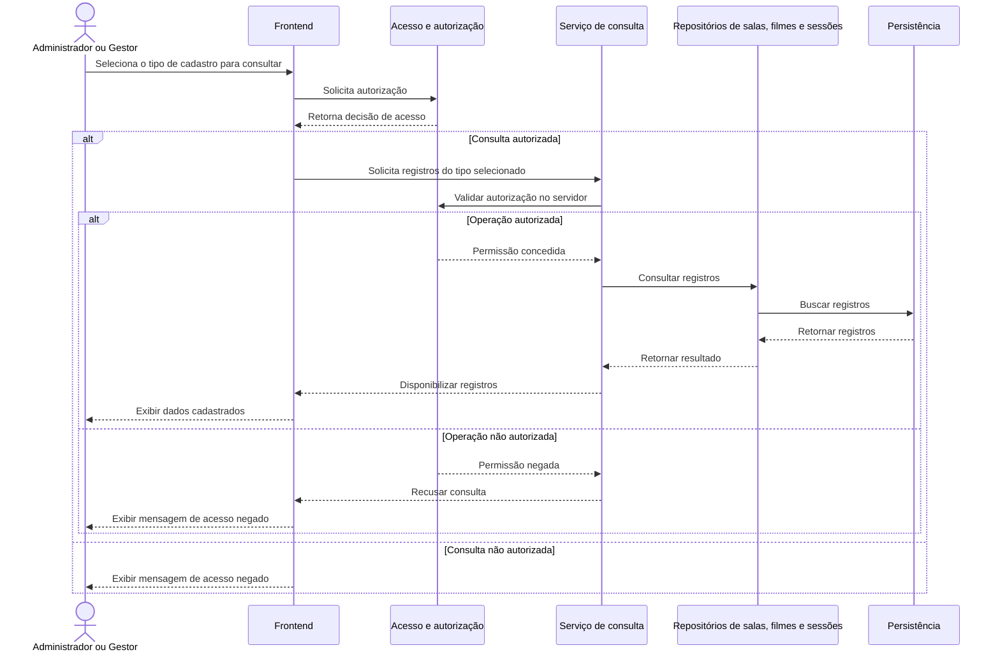

## RF09 — Cadastrar cliente com endereço

**Persona:** Cliente. **RNFs:** RNF01–RNF02, RNF04, RNF10, RNF13–RNF14 e RNF16–RNF17.

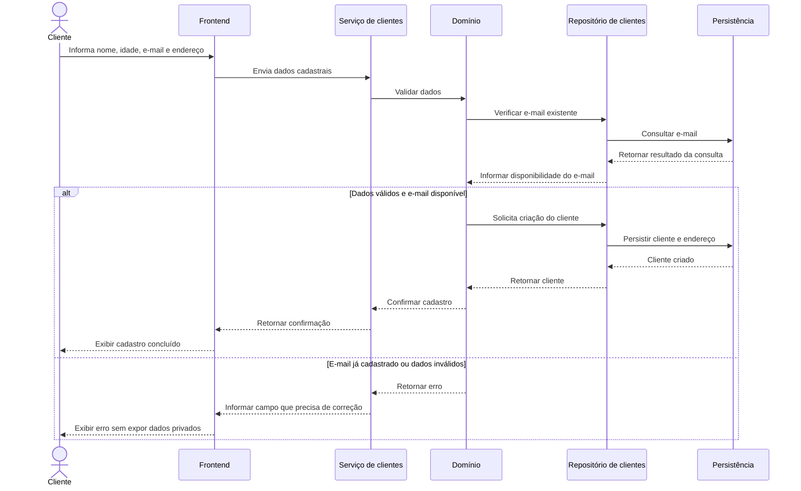

## RF10 — Exigir e-mail único

**Persona:** Cliente. **RNFs:** RNF01, RNF04, RNF10, RNF14 e RNF17.

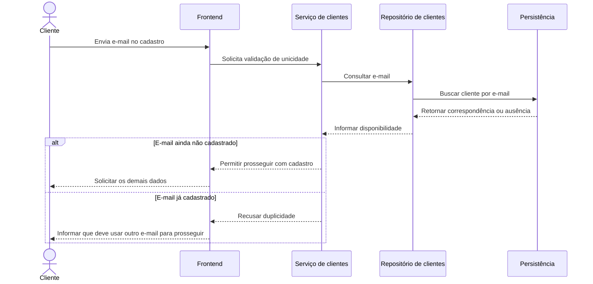

## RF11 — Consultar filmes e sessões disponíveis

**Persona:** Cliente. **RNFs:** RNF01–RNF03, RNF05–RNF07, RNF09 e RNF14.

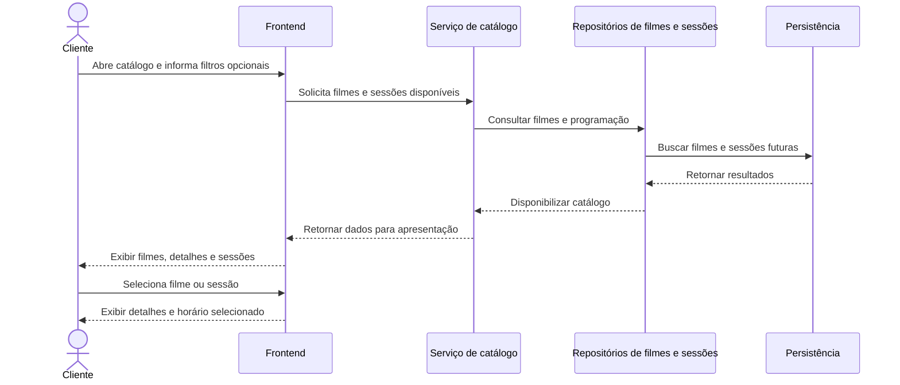

## RF12 — Selecionar assentos disponíveis

**Persona:** Cliente. **RNFs:** RNF01, RNF03, RNF07, RNF09 e RNF11.

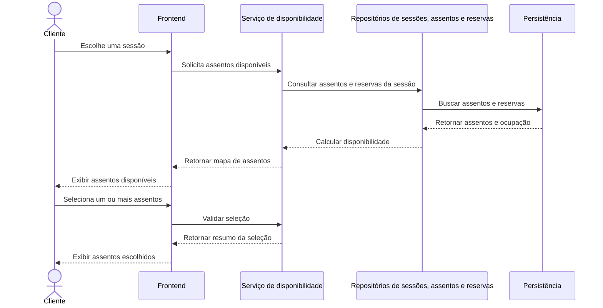

## RF13 — Impedir reserva duplicada do assento na sessão

**Persona:** Cliente. **RNFs:** RNF01, RNF04, RNF11–RNF12 e RNF17.

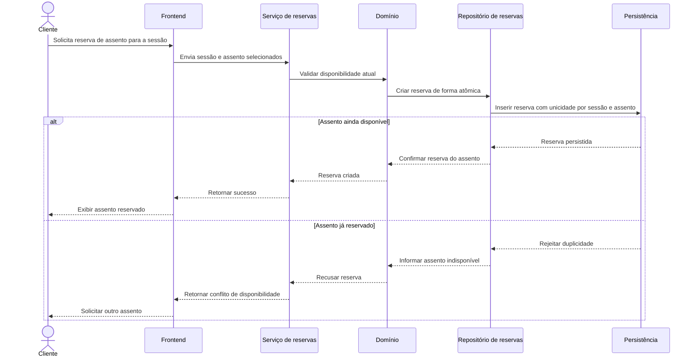

## RF14 — Impedir reserva de sessões com horários conflitantes

**Persona:** Cliente. **RNFs:** RNF01, RNF04, RNF10–RNF12.

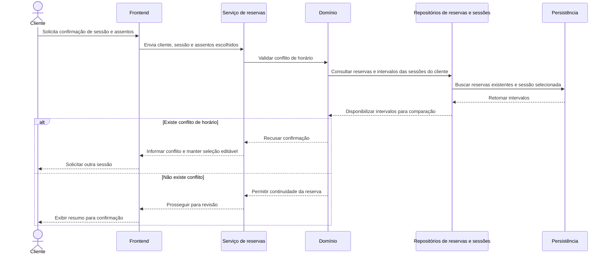

## RF15 — Revisar sessão, assentos e dados antes da confirmação

**Persona:** Cliente. **RNFs:** RNF01–RNF02, RNF05, RNF09–RNF10, RNF14 e RNF16.

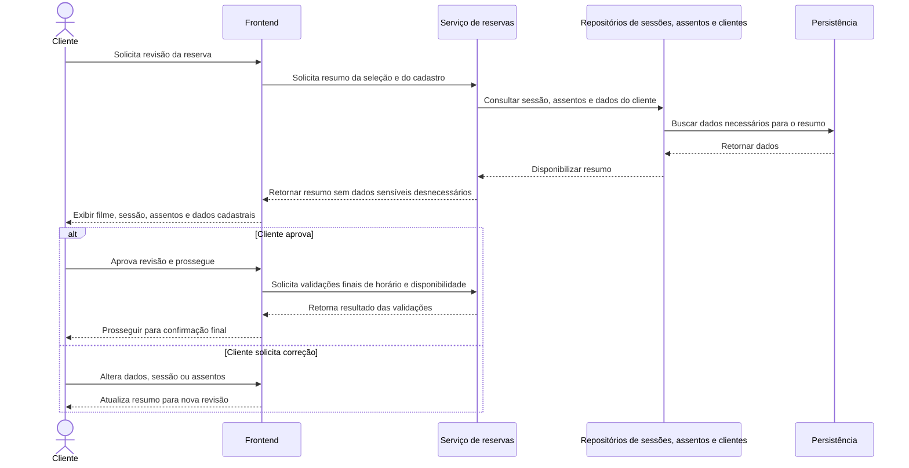

## RF16 — Registrar reserva e apresentar confirmação

**Persona:** Cliente. **RNFs:** RNF01–RNF02, RNF04, RNF11–RNF14 e RNF16.

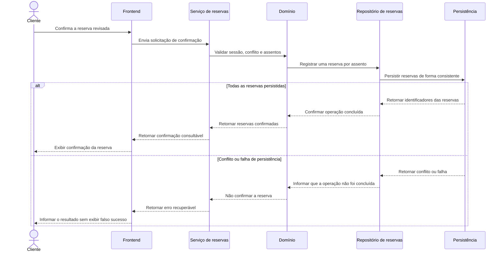
