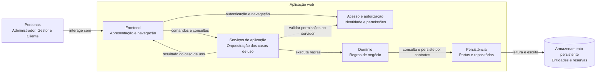

# Diagrama estático de componentes

Diagrama lógico e agnóstico de tecnologia. Os componentes representam responsabilidades, não serviços, frameworks ou produtos específicos. As setas indicam dependências e o texto indica o tipo de interação.

## Responsabilidades e limites

| Componente | Responsabilidade |
|---|---|
| Frontend | Apresentar jornadas, coletar entradas, mostrar validações e resultados sem substituir validações do servidor. |
| Acesso e autorização | Identificar a persona e autorizar operações antes de executar casos de uso. |
| Serviços de aplicação | Coordenar os casos de uso correspondentes aos RF01–RF16 e formatar seus resultados para a interface. |
| Domínio | Aplicar regras de negócio, como disponibilidade de assentos, conflito de sessões e programação nacional. |
| Persistência | Isolar o domínio da tecnologia de armazenamento por contratos de repositório. |
| Armazenamento persistente | Manter os dados das entidades e das reservas; a tecnologia concreta não é definida por este diagrama. |

O diagrama não fixa protocolo, framework, linguagem, arquitetura de implantação nem fornecedor externo. A persistência de contas e credenciais não está definida no modelo atual; o componente de acesso é uma responsabilidade lógica necessária aos fluxos e não presume uma entidade ou provedor específico.
