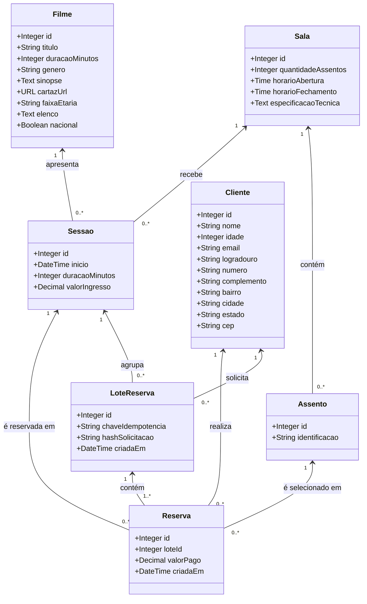

# Diagrama estático de classes das entidades

O diagrama delimita as entidades de negócio do modelo relacional atual. Os tipos são conceituais e não definem uma linguagem de programação.

## Restrições representadas no modelo

- Cada sessão referencia um filme e uma sala.
- Cada assento pertence a uma sala; sua identificação é única dentro da sala.
- Cada reserva referencia um cliente, uma sessão e um assento. A sala vinculada à sessão deve ser a mesma sala do assento.
- Um cliente pode ter várias reservas; o e-mail do cliente é único.
- Um assento pode aparecer em várias reservas ao longo do tempo, mas não mais de uma vez para a mesma sessão.
- Cada reserva representa um assento reservado; a seleção de vários assentos resulta em uma reserva por assento.

As cardinalidades descrevem os relacionamentos persistidos, não garantem sozinhas regras temporais ou de concorrência. A representação de contas e credenciais do administrador e do gestor ainda não foi definida no modelo de dados.
